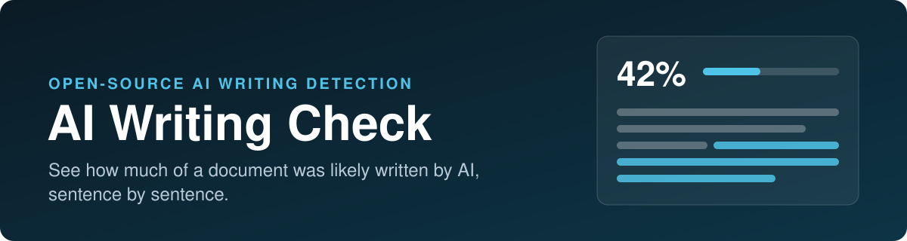
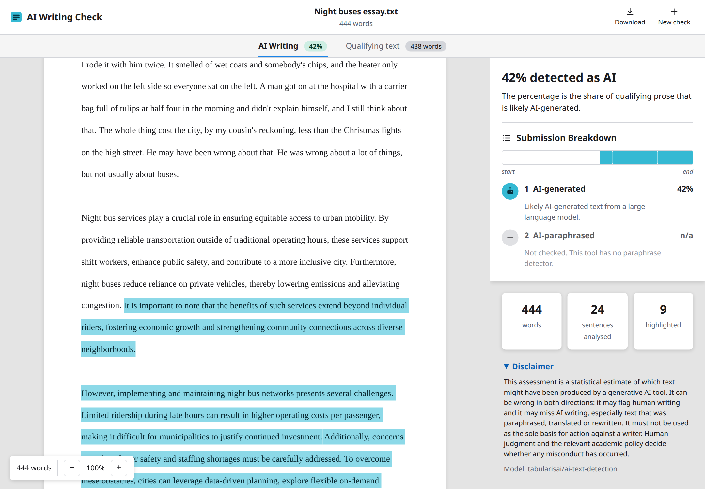

<p align="center">
  
</p>

<p align="center">
  
  
  
  
</p>

**AI Writing Check** is a self-hosted AI writing detector. Paste or upload a document
and get the percentage of its prose that was likely AI-generated, with those sentences
highlighted. It follows the method Turnitin describes publicly for its detector, using
an open model, and runs entirely on your own machine.

<p align="center">
  
</p>

## Features

- **Sentence-level report**: an overall percentage plus highlights on the sentences behind it.
- **Paste or upload**: plain text, `.txt`, `.md`, `.docx` and `.pdf`, up to 30,000 words.
- **Private**: documents never leave your machine; no API keys or accounts.
- **Cautious by design**: no score under 300 words, low scores are withheld, and the
  threshold is tuned for under 1% false positives.
- **Swappable model**: any Hugging Face human/AI text classifier, with a script to measure it.

## Quick start

```bash
python3 -m venv .venv && .venv/bin/pip install -r requirements.txt
.venv/bin/uvicorn aicheck.server:app --port 8000     # then open http://127.0.0.1:8000
.venv/bin/python -m pytest tests                      # unit tests
```

The first request downloads the model (~600 MB). On CPU a 500-word document takes
1-2 seconds once the model is loaded, and a 4,000-word one about 12 seconds.
Try it with `examples/sample.txt`, the essay in the screenshot above.

## How it works

The pipeline has six steps:

1. **Qualifying text** (`aicheck/segment.py`): only prose sentences are analysed.
   Headings, list items, tables and very short lines are skipped.
2. **Overlapping segments**: qualifying sentences are grouped into windows of about
   250 words that advance about 125 words at a time, so most sentences are scored
   two or more times, each time in context.
3. **Segment classifier** (`aicheck/detector.py`): a fine-tuned transformer gives
   each window a score from 0 (human) to 1 (AI).
4. **Pooling** (`aicheck/pipeline.py`): a sentence's score is the mean of every
   window containing it. Sentences at or above the model's threshold are flagged.
5. **Document score**: flagged words as a percentage of qualifying words. It is a
   share of the text, not a probability that the document is AI-written.
6. **Safeguards**: no score below 300 qualifying words; 1-19% is shown as `*%`
   with no highlights; the per-model threshold is set for under 1% false positives.

## Model and measured accuracy

Default: [`tabularisai/ai-text-detection`](https://huggingface.co/tabularisai/ai-text-detection)
(ModernBERT-base, MIT). Change it with `AICHECK_MODEL`, and the cut-off with
`AICHECK_THRESHOLD`; any Hugging Face human/AI text classifier works.

`scripts/evaluate.py` on the HAP-E corpus (~500-word documents, 299 human, 298 per
AI model), share of documents flagged at 20% or more:

| Model, sentence threshold | Human (false positives) | GPT-4o | GPT-4o-mini | Llama-3-70B |
| --- | ---: | ---: | ---: | ---: |
| tabularisai, 0.95 (default) | 0.3% | 96.3% | 97.7% | 98.0% |
| tabularisai, 0.5 | 4.3% | 99.7% | 99.0% | 99.0% |
| fakespot roberta-base, 0.999 | 0.7% | 100% | 100% | 98.7% |
| fakespot roberta-base, 0.5 | 22.4% | 100% | 100% | 100% |

Rerun the script before changing model or threshold; raw scores are not comparable
between models.

## AI-paraphrased text (experimental, off by default)

Turnitin reports a second category: AI text that was then reworded by a paraphrasing
tool. This repo has the plumbing for it, but no model good enough to ship.

- `scripts/train_paraphrase.py` (needs a GPU) paraphrases LLM-written documents, trains
  a second-stage classifier (original AI text vs paraphrased AI text) and tests it.
- Point `AICHECK_PARAPHRASE_MODEL` at the folder it saves and the report splits the
  score into "AI-generated only" and "AI-generated, then AI-paraphrased" (purple).

What one run measured, on 150 held-out topics:

| Test documents | Still flagged as AI by stage 1 | Windows stage 2 calls "paraphrased" |
| --- | ---: | ---: |
| AI, original | 96.0% | 0.4% |
| AI, reworded by the T5 paraphraser it was trained on | 80.5% | 99.0% |
| AI, reworded by a chat model it never saw (Qwen2.5-1.5B) | 97.8% | 12.0% |
| Human | 0.7% | 21.2% (never reaches stage 2 unless stage 1 flags it) |

So the classifier learned to recognise one tool, not paraphrasing in general. Making
it real needs training data from many paraphrasers, with some held out for testing.
The one public three-class model found (`MUSKAN17/AI-DETECTOR`) labelled 87.5% of
*un*-paraphrased AI text as paraphrased, so it is not usable either.

## Known limits

- The false positive figure rests on 299 documents (one false positive), so the true
  rate could plausibly be anywhere up to about 2%.
- Mixed documents are under-counted: a half-human, half-GPT-4o document scored 21%,
  and a 150-word AI passage inside 1,400 human words was not flagged at all.
- Paraphrasing weakens detection: a sentence-level paraphraser cut the detection rate
  from 96% to 80.5%. Text reworded by hand is not measured at all.
- Not measured: "humanizer" tools, non-native English writers,
  other languages, and models newer than the 2024 ones in the test set.
- The AI-paraphrased category is experimental and off by default (see above).

A result here is a statistical estimate, not evidence of misconduct.

This project is independent and is not affiliated with or endorsed by Turnitin.
